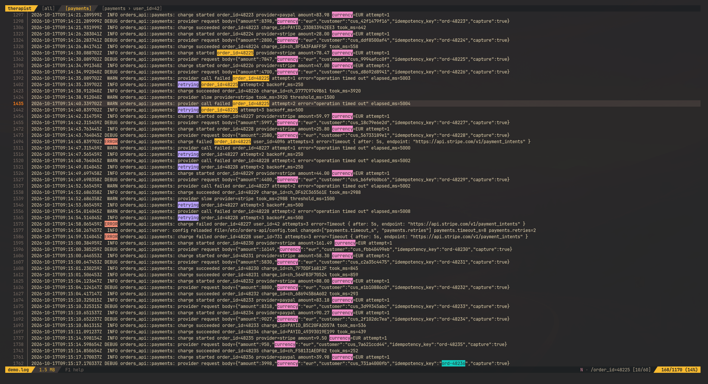

# therapist

[](https://github.com/M-Komorek/therapist/actions)
[](https://crates.io/crates/therapist)
[](LICENSE)

Sometimes your system needs a little **therapy**. So here it is: a **BLAZINGLY FAST** terminal log viewer. Open a multi-GB log at once, move with vim keys, and narrow it down with grep tabs, search, bookmarks and highlights. Just hope that after the session you're not the one who needs **therapy**.



## Features

- **Huge files.** A multi-GB file opens at once and is indexed in the background - you can move through the lines indexed so far. Memory stays small, because the index stores a checkpoint every 1,000 lines (or 64 KiB), not the position of every line.
- **Vim motions.** Move with `j` `k` `gg` `G` `Ctrl-d` `Ctrl-u` `Ctrl-f` `Ctrl-b`, add a count (`20j`, `500G`), and scroll long lines sideways with `h` `l` `0`.
- **Search.** `/` and `?` find a phrase, `n` and `N` jump between matches, and the status bar shows which match you're on (`[3/41]`).
- **Cascading grep tabs.** Grep for `ERROR` to open a tab with only those lines, then grep that tab for `user=42` to get `[ERROR › user=42]`. A tab fills while its grep runs, keeps its own cursor and search, and shows the file's original line numbers.
- **Bookmarks.** Bookmark a line, see the mark in every tab that shows that line, and jump from one bookmark to the next.
- **Highlights.** Give phrases their own colors, shown in every tab. There are 12 colors, reused after that.
- **Messy lines.** Invalid UTF-8, CRLF line endings, tabs and ANSI color codes don't break the view: tabs line up and color codes are hidden.

## Installation

therapist runs on Linux and macOS. It needs Rust 1.91 or newer.

```bash
cargo install therapist
```

Or the latest from GitHub:

```bash
cargo install --git https://github.com/M-Komorek/therapist
```

Or from a clone:

```bash
git clone https://github.com/M-Komorek/therapist
cd therapist
cargo install --path .
```

Each way installs the command `thr`.

## Usage

```bash
thr app.log
```

Press `F1` in the app for the list of keys.

### Key bindings

Moving needs no prefix. Changing something starts with `Space`:
- Plain keys move: through lines, matches, bookmarks and tabs.
- `Space` + a letter adds or removes one thing: a bookmark, a grep tab, a highlight.
- `Space` + the capital letter removes all of them.

So <kbd>Space</kbd> <kbd>b</kbd> toggles one bookmark and <kbd>Space</kbd> <kbd>B</kbd> removes them all.


| Key | Action |
|---|---|
| **Moving** | |
| <kbd>j</kbd> <kbd>k</kbd> | Move the cursor down / up [count] lines |
| <kbd>g</kbd><kbd>g</kbd> | Go to the first line |
| <kbd>G</kbd> | Go to the last line, or to line [count] |
| <kbd>Ctrl</kbd>+<kbd>d</kbd> <kbd>Ctrl</kbd>+<kbd>u</kbd> | Scroll half a page down / up |
| <kbd>Ctrl</kbd>+<kbd>f</kbd> <kbd>Ctrl</kbd>+<kbd>b</kbd> | Scroll a page down / up |
| **Scrolling sideways** | |
| <kbd>h</kbd> <kbd>l</kbd> | Scroll left / right [count] wide steps |
| <kbd>0</kbd> | Scroll back to the first column |
| **Searching** | |
| <kbd>/</kbd> <kbd>?</kbd> | Search forward / backward |
| <kbd>n</kbd> <kbd>N</kbd> | Jump to the next / previous match |
| <kbd>Esc</kbd> | Clear the search |
| **Bookmarks** | |
| <kbd>Space</kbd> <kbd>b</kbd> | Toggle the bookmark on the cursor line |
| <kbd>Space</kbd> <kbd>B</kbd> | Remove all bookmarks |
| <kbd>]</kbd> <kbd>[</kbd> | Jump to the next / previous bookmark |
| **Tabs** | |
| <kbd>Space</kbd> <kbd>g</kbd> | Grep the active tab's lines into a new tab |
| <kbd>H</kbd> <kbd>L</kbd> | Switch to the previous / next tab |
| <kbd>Space</kbd> <kbd>x</kbd> | Close the active tab |
| <kbd>Space</kbd> <kbd>X</kbd> | Close every grep tab |
| **Highlights** | |
| <kbd>Space</kbd> <kbd>h</kbd> | Toggle the highlight of a phrase |
| <kbd>Space</kbd> <kbd>H</kbd> | Remove all highlights |
| **General** | |
| <kbd>F1</kbd> | Show the key help |
| <kbd>Ctrl</kbd>+<kbd>z</kbd> | Suspend to the shell |
| <kbd>q</kbd> | Quit |


### Matching

Search, grep and highlights match plain text, case-sensitively. There are no regular expressions: `user=42` finds exactly `user=42`.

### therapist's own log

therapist writes its own log to `$XDG_STATE_HOME/therapist/therapist.log`, which is `~/.local/state/therapist/therapist.log` by default. Move it with `--therapist-log PATH`, and set the level with `THERAPIST_LOG` (default `info`):

```bash
THERAPIST_LOG=debug thr app.log
```

If the app crashes, it says where this log is.

## This is fine 🧘

These were design decisions (for real, lol), and everyone is calm about it:

- Bookmarks and highlights are gone when you quit. What happens in the session stays in the session.
- therapist reads files, not pipes or stdin. Save the output first: `kubectl logs my-pod > app.log`.

## Development

```bash
cargo run -- path/to/file.log
```

Before sending a change, run what CI runs:

```bash
cargo fmt
cargo clippy --all-targets -- -D warnings
cargo test
RUSTDOCFLAGS="-D warnings" cargo doc --no-deps
```

`Ctrl-p` panics on purpose in debug builds, to check that the terminal is restored.

## License

[MIT](LICENSE)
